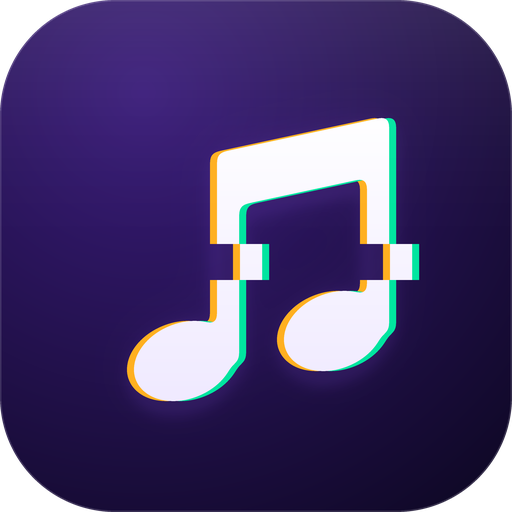
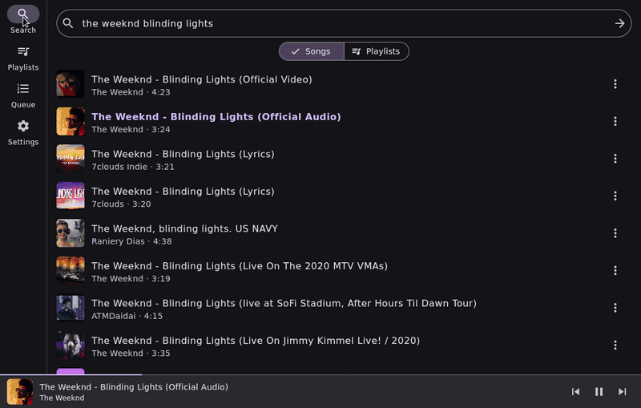
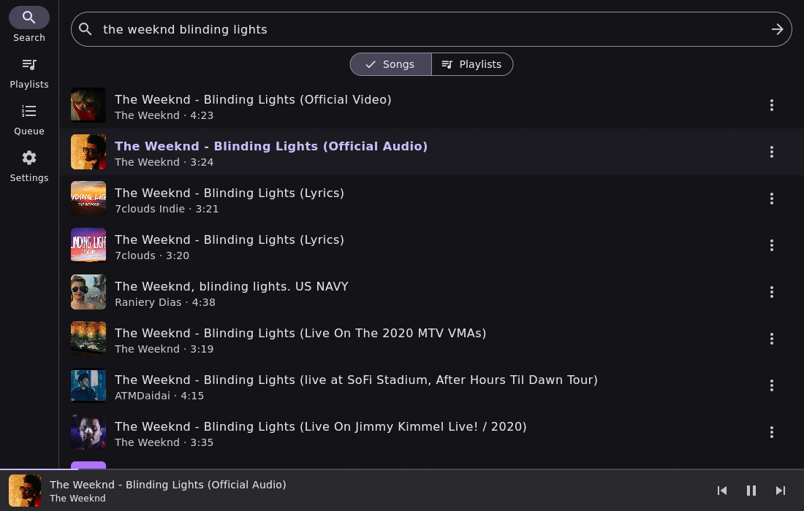
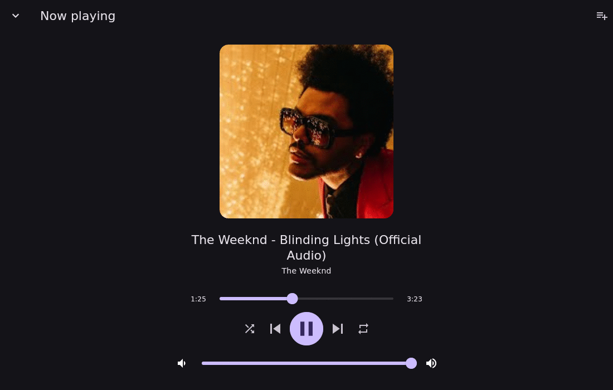
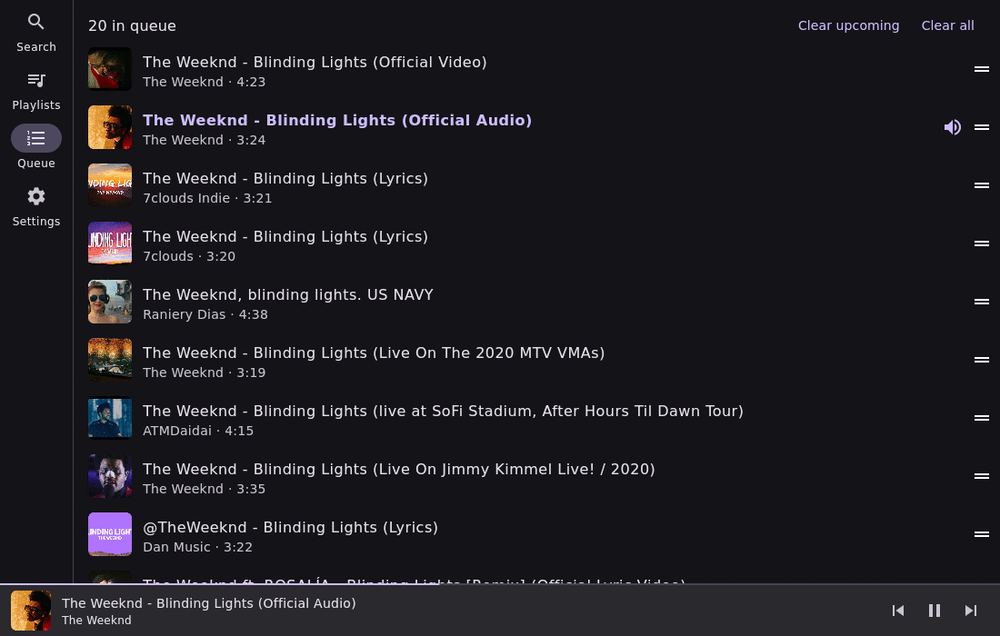
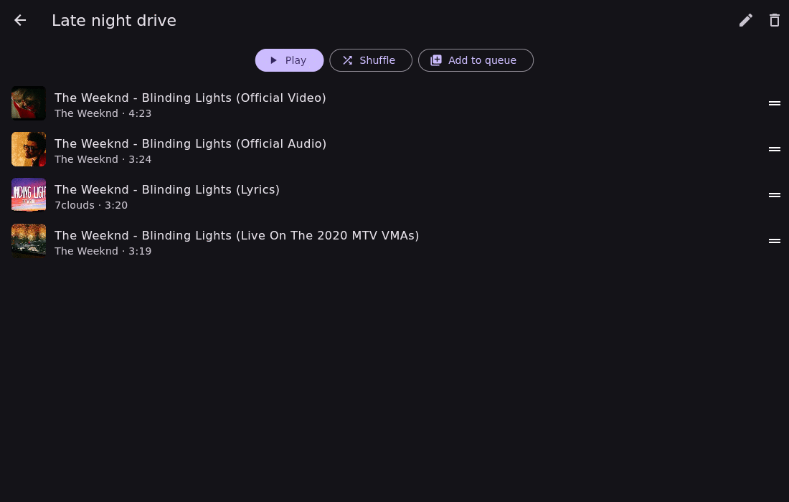
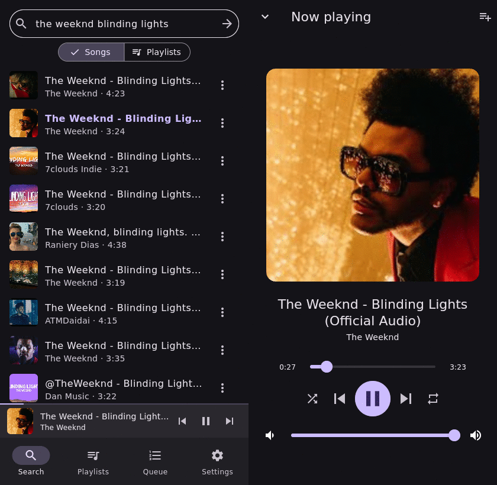

<div align="center">



# 404 Tunes

**A music player for Android and desktop that streams from YouTube with yt-dlp.**<br>
Everything runs inside the app. No server, no account, no ads.

[](https://github.com/aimansam/404tunes/releases/latest)
[](https://github.com/aimansam/404tunes/releases)
[](https://github.com/aimansam/404tunes/actions/workflows/ci.yml)


<br>



</div>

## Download

Grab the latest build from the **[Releases page](https://github.com/aimansam/404tunes/releases/latest)**.

| Platform | File | Notes |
| --- | --- | --- |
| **Windows** | `404tunes-windows-x64-setup.exe` | Installer for the current user: no admin rights, Start menu entry, uninstaller. A portable `.zip` is also there. |
| **Android** | `app-arm64-v8a-release.apk` | For almost every phone made since 2017. `armeabi-v7a` is for old 32-bit phones, `x86_64` for emulators. Sideload it (Google Play does not allow this kind of app). |
| **macOS** | `404tunes-macos-arm64.zip` | Apple silicon. The app is unsigned: right-click it and choose **Open** the first time. |
| **Linux** | `404tunes-linux-x64.tar.gz` | Needs `libmpv` (`sudo apt install libmpv2`). Unpack and run `bundle/tunes404`. |

Windows will show "Windows protected your PC" because the builds are not code-signed: choose **More info → Run anyway**.

## Features

- **Search** songs and playlists, then play, seek, shuffle and repeat
- **Queue** you can reorder, with *play next* and *add to queue*; it is saved and restored
- **Playlists** per profile: build your own from search, or save a YouTube playlist
- **Profiles** on one device: the first launch creates the **admin**, who adds other people, each with their own PIN, playlists and queue
- **Offline cache** (optional, size limit, least-recently-used cleanup): cached songs play without internet
- **Android**: media notification, lock-screen and headset controls, background playback
- **Discord Rich Presence** on desktop (off by default): "Listening to 404 Tunes" with the song, artist, cover and a progress bar
- **Updates itself**: Windows (installer version) and Android download and install new releases from inside the app; macOS, Linux and the portable Windows zip tell you when one is out
- **Stays working**: yt-dlp updates itself daily. When YouTube asks to "confirm you're not a bot", the app tries other ways to get the song, and you can add a `cookies.txt`
- **Desktop shortcuts**: `Space` play/pause (not while typing), `Ctrl+←` / `Ctrl+→` previous / next

<div align="center">

| Search | Now playing |
| :---: | :---: |
|  |  |
| **Queue** | **Playlist** |
|  |  |



</div>

> **YouTube's terms:** playing YouTube audio outside YouTube's own player goes against its terms of service. This is a personal-use
> tool, and it can't be published on Google Play for that reason, so Android is a sideloaded APK.
>
> **Profiles are a lock, not encryption.** They keep people's playlists apart on one device. The database file is not encrypted.

## Using it

1. First launch: choose an admin name and a PIN or password (4+ characters). There are no default credentials.
2. **Search** songs or playlists and tap a song to play (playback continues through the results). The "…" menu adds to the queue or a playlist.
3. **Settings → Manage profiles** (admin) to add people. Each profile signs in with its own PIN.
4. **Settings → Offline cache** to keep played songs on the device.

### "Confirm you're not a bot"

YouTube sometimes refuses to hand out a song until you prove you're not a bot. The app first tries to get the song another way by itself
(this can take 15 seconds or more the first time). While that fallback is in use, sound quality is lower, more data is used, and songs may not be saved to the offline cache.
There is no guaranteed way past the check. If the message stays:

1. **Add your cookies.** Exported like this, they last longer:
   1. Open a private window and sign in to YouTube. A spare account is safer, because an account used this way can be banned.
   2. In the same tab, go to <https://www.youtube.com/robots.txt>.
   3. Export the `youtube.com` cookies as a Netscape-format `cookies.txt` (a [browser extension](https://github.com/yt-dlp/yt-dlp/wiki/FAQ#how-do-i-pass-cookies-to-yt-dlp) does this), then close the window.
   4. In the app, choose the file under **Settings → Cookies file**. Keep it private: it gives access to that account.
2. **Change your connection:** turn off a VPN, try another network, or wait a while.

### Updates

The app asks GitHub for the latest release at launch and once a day (turn that off under **Settings → Updates**, where you can also check by hand).

| Where | What happens when you choose **Update** |
| --- | --- |
| Windows, installed with the setup | Downloads the new installer, closes, installs it silently and opens again |
| Android | Downloads the APK for your phone; Android asks you to confirm. The first time you also allow 404 Tunes to install apps |
| macOS, Linux, portable Windows zip | Opens the release page |

Nothing is installed unless it is verified: each release carries `update.json` (size and SHA-256 of every file), signed with an Ed25519 key whose public half is built into the app.
Android additionally refuses an APK that is not signed with the same key as the installed app.
Versions up to 0.2.5 have no updater, so install a newer one by hand once.

### Discord Rich Presence (desktop)

The app talks to the **Discord desktop app** over its local socket (unix socket on Linux and macOS, named pipe on Windows): no server, no login.
Turn it on under **Settings → Discord**. It shows while a song plays and disappears on pause or stop. It only works while the Discord desktop app runs on the same machine
(the Flatpak and Snap versions are found too). Android can't do this, because the Discord mobile app has no local socket for other apps.
The status shows the song title to your Discord friends, which is why it is off by default.

If you build the app yourself, Discord needs an application on its side, which gives the name shown on your profile:

1. Create an application at <https://discord.com/developers/applications> named **404 Tunes** (the logo is `assets/branding/logo.png`).
2. Copy its **Application ID** (not a secret).
3. Bake it into your builds so users only flip the switch (the ID field is hidden in those builds), or, in a build without one, type it into **Settings → Discord → Discord application ID**:
   ```bash
   flutter run -d linux --dart-define=DISCORD_CLIENT_ID=123456789012345678       # local builds
   gh api -X POST repos/OWNER/REPO/actions/variables -f name=DISCORD_CLIENT_ID -f value=123456789012345678
   # or: Settings → Secrets and variables → Actions → Variables. The release workflow passes it as --dart-define.
   ```

## How it works

```
Flutter UI
 ├─ YtDlpService          search / playlist / resolve / download, caches, retries (shared Dart code)
 │    └─ YtBackend        desktop: runs the bundled yt-dlp binary    android: youtubedl-android (Python + yt-dlp) via a Kotlin plugin
 ├─ PlayerController      queue + just_audio (desktop: libmpv via media_kit; Android: ExoPlayer) + audio_service
 ├─ PresenceService       Discord Rich Presence over Discord's local socket (desktop)
 ├─ SQLite                profiles, playlists, saved queue
 └─ CacheManager          optional offline cache
```

**Finding a playable link** (the part YouTube keeps changing, see `lib/yt/ytdlp_service.dart`):
1. yt-dlp **without** a JavaScript runtime (~2 s). yt-dlp then uses a YouTube client whose links need no challenge. The link is checked with a 2-byte
   `Range` request.
2. If that fails (or yt-dlp finds no audio), yt-dlp again **with** the bundled [quickjs-ng](https://github.com/quickjs-ng/quickjs) runtime to solve YouTube's
   challenges (~10 s on a PC; slower on a phone).
3. If YouTube answers step 2 with its bot check, yt-dlp is asked again with other player clients (`android`, `mweb`, then `tv_simply`). The first link that
   passes the `Range` check wins, and that client goes first for 30 minutes. They mostly offer one combined 360p file with sound, so they are only a fallback.
4. The next song in the queue is looked up while the current one plays, so the next one starts instantly.

(deno was tried as the runtime and rejected: deno 2.9.8 produced challenge answers that YouTube answered with HTTP 403, quickjs-ng's were accepted.)

## Build from source

Needs the [Flutter SDK](https://docs.flutter.dev/get-started/install) (3.x) and, for Android, the Android SDK (platform 36, build-tools 36).

```bash
tool/fetch_binaries.sh          # downloads yt-dlp + quickjs for desktop (assets/bin/) and quickjs for Android (jniLibs/)
flutter pub get

flutter run -d linux            # or windows / macos
flutter build linux --release   # desktop build: needs clang, cmake, ninja, GTK 3 and libmpv dev packages on Linux
flutter build apk --release --split-per-abi   # Android APKs (arm64-v8a is what most phones need)
```

Linux needs `libmpv` at runtime too (`sudo apt install libmpv2`, or `libmpv-dev` to build).
The Windows and macOS binaries are fetched by the script, but those platforms can only be built on Windows / macOS (the release workflow does it).
macOS: the bundled quickjs is the Apple-silicon build.

The app icon and logo are drawn by `tool/make_icons.py` (Pillow + numpy), which writes every platform's icon set.

### Release signing (Android)

Release APKs are signed with the key named in `android/key.properties` (not in git, together with the `.jks` keystore). Without that file the
release build falls back to the debug key, so a fresh clone still builds. To make your own key:

```bash
keytool -genkeypair -keystore android/my-release.jks -storetype PKCS12 -alias myalias -keyalg RSA -keysize 4096 -validity 36500
# android/key.properties:
#   storePassword=...   keyPassword=...   keyAlias=myalias   storeFile=my-release.jks   (path relative to android/)
```

Keep the keystore and its password backed up: an app can only be updated in place by APKs signed with the same key.

### Update signing

The release workflow signs `update.json` with the secret `UPDATE_SIGNING_KEY`, which must match `lib/update/update_key.dart` (the build refuses to publish otherwise).
To set up your own (for a fork, say):

```bash
openssl genpkey -algorithm ed25519 -out update-signing-key.pem       # keep this safe and out of git
openssl pkey -in update-signing-key.pem -pubout -outform DER | tail -c 32 | base64   # put this in lib/update/update_key.dart
gh secret set UPDATE_SIGNING_KEY < update-signing-key.pem
```

Also set the repository name in `lib/update/updater.dart`. If the key is lost, installed apps can't verify newer releases: people have to update once by hand.

### Releases (GitHub Actions)

`.github/workflows/release.yml` builds Android, Linux, Windows (installer + portable zip) and macOS (Apple silicon) and attaches them to a release when you push a version tag.
The tag (`vMAJOR.MINOR.PATCH`) becomes the app's version:

```bash
git tag v1.2.3 && git push origin v1.2.3     # use the next version number
```

A tag build refuses to run without the signing secrets, so debug-signed APKs can't be published by accident. Add them once under
Settings → Secrets and variables → Actions, or with the `gh` CLI:

```bash
base64 -w0 android/404tunes-release.jks | gh secret set ANDROID_KEYSTORE_BASE64
gh secret set ANDROID_KEYSTORE_PASSWORD        # the password in android/key.properties
gh secret set ANDROID_KEY_ALIAS --body tunes404
```

"Run workflow" on the Actions tab builds everything for testing and keeps the files as artifacts without making a release.
The Windows and macOS builds are unsigned: Windows SmartScreen and macOS Gatekeeper will warn on first launch.

## Tests

```bash
flutter analyze
flutter test                                  # parsers (real yt-dlp output fixtures), queue, profiles/admin rules, playlists, service logic and errors, cache, updater, Discord client
SMOKE=1 flutter test test/smoke_test.dart     # the same code against real YouTube (needs internet and the fetched binaries)
```

## Limits

- No iOS: iOS apps can't run yt-dlp.
- Live streams can't be played.
- **Tested:** the Linux build end to end, and Windows with real playback and a real Discord client. **Not tested on real hardware:** the Android APK (it builds and its contents are verified, but no phone or emulator was available) and the macOS build (it builds in CI).
- Discord Rich Presence on Linux and macOS was tested against a stand-in for Discord only.
- Installing an update from inside the app was tested on Windows under Wine only, and not yet on Android.
- The bot check fallback was tested against a simulated check only.
